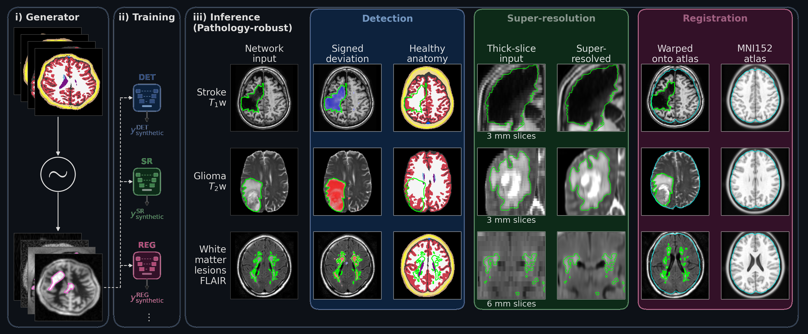
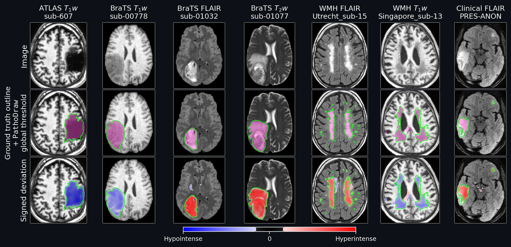

# Pathology Randomization for Synthetic Priors and Zero-Shot Detection (`PathoDraw`)

[](assets/overview_dark.png)
_One synthetic generator, three zero-shot tasks: detection, super-resolution and registration of stroke, glioma and white matter lesions._

## Summary

`PathoDraw` trains neuroimaging networks on synthetic images by randomizing pathology. No real pathological scan, lesion mask or patient data enters training. The result is a single contrast-agnostic network that:

- **detects lesions zero-shot** on stroke, glioma and white matter hyperintensity datasets and on uncurated clinical [PRES](https://en.wikipedia.org/wiki/Posterior_reversible_encephalopathy_syndrome) data;
- **super-resolves** clinical acquisitions with pathology;
- **registers** scans with pathology to an atlas, fine-tuned from the same trunk.

[](assets/teaser_dark.png)
_Zero-shot detection on stroke ([ATLAS](https://fcon_1000.projects.nitrc.org/indi/retro/atlas.html)), glioma ([BraTS](https://www.synapse.org/#!Synapse:syn51156910)), white matter hyperintensities ([WMH](https://wmh.isi.uu.nl/)) and [PRES](https://en.wikipedia.org/wiki/Posterior_reversible_encephalopathy_syndrome)._

## Preliminaries

Training requires only healthy label maps, no images are needed. Paths come from environment variables: `PR_DATA_DIR` contains label maps, `PR_OUT_DIR` contains runs and checkpoints, `PR_EVAL_DATA_ROOT` contains evaluation datasets ([ATLAS](https://fcon_1000.projects.nitrc.org/indi/retro/atlas.html), [BraTS2023-GLI](https://www.synapse.org/#!Synapse:syn51156910), [WMH_seg_challenge](https://wmh.isi.uu.nl/), etc.) and `PR_DERIV_ROOT` contains inference maps.

## Installation

Clone the repository with

```
git clone https://github.com/agr78/Pathology-Randomizer.git
cd Pathology-Randomizer
```

and create the `pathodraw` environment with

```
source ./install.sh
```

which queries and exports the paths above.

## Usage

**Train** the detector:

```
python train.py --max_steps 500000 --pathology_prob 0.5 \
  --reg_head mlp --tissue_rel --lesion_comp vascular:0.5,local:0.5,tract:0.3 --target_region 0.18 \
  --attention --attention_identity_init --dark_csf 0.5 \
  --ema 0.9999 --lr_decay_from 400000 --lr_final_mult 0.1 --seed 1 --tag pathodraw_s1
```

Rendering and training share one GPU by default and are parallelized across two with `--gen_device cuda:1`.

Fine-tune the super-resolution and registration heads from the trained trunk:

```
python train_downstream.py --super_resolve --healthy --pathology_prob 0.0 --init_from /path/to/synthseg_300000.pth \
  --steps 200000 --bspline_zoom --strip_prob 0.5 --sr_calibrate --tag sr_s1
python train_downstream.py --register --pathology_prob 0.5 --init_from /path/to/synthseg_300000.pth \
  --steps 100000 --affine_prealign fit --prealign_iters 300 --smooth_on displacement --tag reg_s1
```

**Infer** with the pretrained weights:

```
python compare_datasets.py --dataset ATLAS --mask --checkpoint_path weights/pathodraw_detector_s1_500k_ema.pth --single_model
python compare_datasets.py --dataset BraTS2023-GLI --modality FLAIR --target 1 2 3 --mask --checkpoint_path weights/pathodraw_detector_s1_500k_ema.pth --single_model
```

The three reported models are under `weights/`: `pathodraw_detector_s1_500k_ema.pth`, `pathodraw_superres_s1_200k.pth` and `pathodraw_register_s1_100k.pth`.

## Publications

Alexandra G. Roberts, Tonmoy Hossain, Mark Olchanyi, Stefan Brandstätter, Jonathan Williams Ramirez, Ana Lawry Aguila, Matthew Rosen, Annabel Sorby-Adams, W. Taylor Kimberly and Juan Eugenio Iglesias, *Pathology Randomization for Synthetic Priors and Zero-Shot Detection*, [arXiv:2611.21975](https://arxiv.org/abs/2611.21975), 2026.

## BibTex

```
@article{roberts2026pathodraw,
  title   = {Pathology Randomization for Synthetic Priors and Zero-Shot Detection},
  author  = {Roberts, Alexandra G. and Hossain, Tonmoy and Olchanyi, Mark and Brandst{\"a}tter, Stefan and Williams Ramirez, Jonathan and Lawry Aguila, Ana and Rosen, Matthew and Sorby-Adams, Annabel and Kimberly, W. Taylor and Iglesias, Juan Eugenio},
  journal = {arXiv preprint arXiv:2611.21975},
  year    = {2026}
}
```

## Contact

Please direct questions to [Alexandra G. Roberts](https://alexandragroberts.com) at aroberts34@mgh.harvard.edu.
